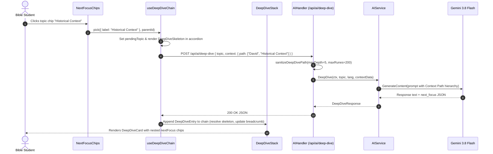
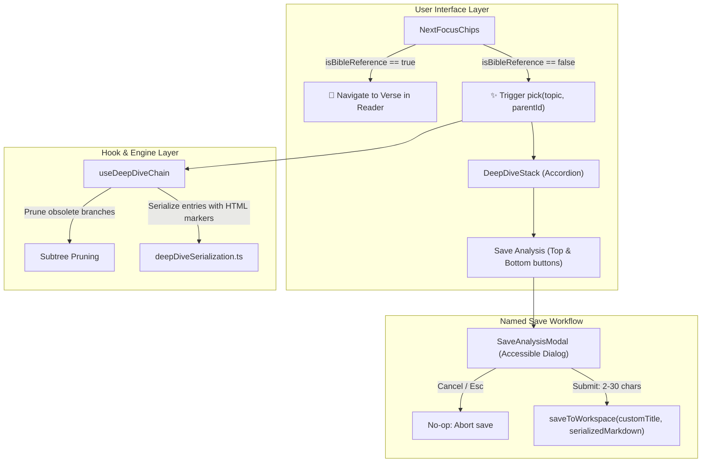

# PR Story: 118-feat-ai-deepening-chain-and-pending-feedback

> **PR Story Type:** Extended Template  
> **Topic Branch:** `feat/deepening-ai-features`  
> **Related Plan:** `.plans/ai-deepening/00-overview.md`  
> **Security Audit:** `.security_audits/security-audit-2026-11-05-ai-deepening.md`  
> **Semantic Version:** `3.16.0` (`minor`)

---

## 1. Executive Summary

### 1.1 Problem Statement
In previous releases, Bible study AI insights across reader, comparison, and analytics views included actionable `next_focus` suggestions. However:
1. Selecting a suggestion replaced the entire previous deep dive without retention, discarding prior context.
2. Clicking a chip provided zero tactile pending feedback; users were uncertain if requests were dispatched.
3. The backend lacked context path awareness, leading the LLM to potentially repeat previous insights when drilling down into subtopics.
4. Bible verse references (which navigate to reader passages) and conceptual deep dive topics (which trigger AI explorations) were visually indistinguishable.
5. Saving analyses to the workspace automatically assigned arbitrary hardcoded names, and long accordion stacks forced cumbersome scrolling to access the single save button.

### 1.2 Proposed Solution
This PR delivers an end-to-end chained AI deep dive architecture:
1. **Frontend Chain State Machine (`useDeepDiveChain`):** Implements an accordion stack preserving exploration history, tracking per-chip pending state, and auto-scrolling to new drill-downs.
2. **Context Path Propagation & Subtree Pruning:** Passes `context.path` (up to 5 breadcrumb segments) to backend prompts and gracefully prunes sibling subtrees when branching out.
3. **Backend Validation & Security Hardening:** Validates `context.path` in `backend/internal/api/ai_handler.go` with strict depth (`maxPathDepth = 5`) and segment length limits (`maxSegmentRunes = 200`), and embeds parent context into Gemini prompts.
4. **Visual Differentiation & Micro-Legend (`NextFocusChips`):** Visually bifurcates navigation verse references (📖 Blue) from AI deep dives (✨ Purple) with accessible ARIA descriptions and a subtle micro-legend.
5. **Interactive Named Workspace Saving (`SaveAnalysisModal`):** Prompts users with an accessible modal dialog requiring an explicit title (2–30 characters), prevents saving on cancellation, and adds a second save button at the bottom of long exploration stacks.

---

## 2. Architecture & Data Flow

---

## 3. Files Changed

| File Path | Modifications |
| --- | --- |
| `backend/internal/api/ai_handler.go` | Added `sanitizeDeepDivePath` checking array type, depth (`<=5`), and rune length (`<=200`). |
| `backend/internal/api/ai_handler_test.go` | Added comprehensive unit tests for path sanitization and boundary rejection. |
| `backend/internal/services/ai_service.go` | Formatted sanitized context path into LLM prompt context string. |
| `backend/internal/services/ai_service_test.go` | Added unit tests verifying context path prompt enrichment. |
| `backend/internal/config/config.go` | Bumped default Gemini models to `gemini-3.8-flash`. |
| `frontend/src/types/ai.ts` | Added `DeepDiveEntry`, `DeepDiveChain`, and `DeepDiveContext` interfaces. |
| `frontend/src/hooks/useDeepDiveChain.ts` | New hook managing chained accordion state, pending feedback, and subtree pruning. |
| `frontend/src/hooks/useDeepDiveChain.test.tsx` | 13 Vitest tests verifying chain state, pruning, errors, and reset behavior. |
| `frontend/src/components/layout/DeepDiveStack.tsx` | Accordion component displaying breadcrumbed exploration steps. |
| `frontend/src/components/layout/DeepDiveStack.test.tsx` | Unit tests for accordion toggling, active cards, and auto-scroll behavior. |
| `frontend/src/components/layout/DeepDiveCard.tsx` | Individual card rendering markdown, nested `NextFocusChips`, and breadcrumbs. |
| `frontend/src/components/layout/DeepDiveCard.test.tsx` | Unit tests for card rendering, chip propagation, and copy actions. |
| `frontend/src/components/layout/DeepDiveBreadcrumb.tsx` | Visual breadcrumb component tracing exploratory lineage. |
| `frontend/src/components/layout/DeepDiveSkeleton.tsx` | Shimmer loading skeleton with tactile feedback. |
| `frontend/src/components/layout/SaveAnalysisModal.tsx` | Accessible modal prompting user for custom analysis name (2–30 chars). |
| `frontend/src/components/layout/SaveAnalysisModal.test.tsx` | Unit tests validating length bounds, keyboard actions, and callbacks. |
| `frontend/src/components/search/NextFocusChips.tsx` | Bifurcated chips (Verse 📖 vs AI ✨) and micro-legend. |
| `frontend/src/components/search/NextFocusChips.test.tsx` | Unit tests for visual differentiation, keyboard access, and legend. |
| `frontend/src/components/reader/VerseReader.tsx` | Integrated `useDeepDiveChain`, dual save buttons, and `SaveAnalysisModal`. |
| `frontend/src/components/compare/CompareView.tsx` | Integrated `useDeepDiveChain`, dual save buttons, and `SaveAnalysisModal`. |
| `frontend/src/components/analytics/AnalyticsView.tsx` | Integrated `useDeepDiveChain`, dual save buttons, and `SaveAnalysisModal`. |
| `frontend/src/utils/deepDiveSerialization.ts` | Marker-based markdown serializer/deserializer for multi-step chains. |
| `frontend/src/utils/bookNames.ts` | Refined Finnish & English Bible book regex matching. |
| `frontend/src/utils/i18n.ts` | Added bilingual keys for modal, legend, chips, and deep dive actions. |
| `.security_audits/security-audit-2026-11-05-ai-deepening.md` | Security audit covering CWE-285, CWE-400, CWE-20, CWE-116, and CWE-79. |
| `VERSION`, `package.json`, `version.go`, `version.ts` | Bumped version to `3.16.0`. |

---

## 4. Quality Gates & Verification

- **Backend Quality Gates (`task backend:check`):**
  - Go formatting & staticcheck: Passed clean.
  - Unit tests & coverage: Passed clean (77.6% coverage across services and handlers).
- **Frontend Quality Gates (`task frontend:check`):**
  - TypeScript compilation (`tsc -b`): 0 errors.
  - ESLint validation: 0 warnings, 0 errors.
  - Vitest test suite: **66 test files passed, 465 unit & integration tests passed (100%)**.
- **Security Audit:**
  - Full static audit completed and documented under `.security_audits/security-audit-2026-11-05-ai-deepening.md`.
